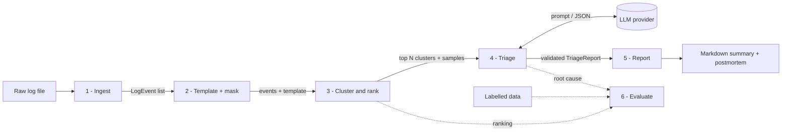
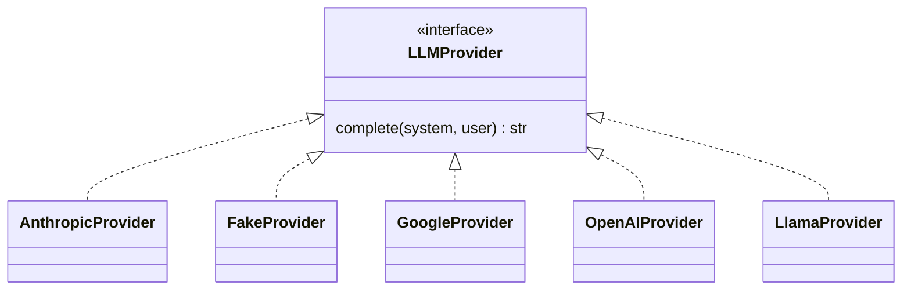
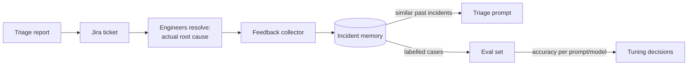

# Architecture

## Goal
Given a raw application log, produce a short incident report that a human on call can act on:
what went wrong, the probable root cause, the evidence for it, and suggested next steps.
The LLM explains and summarises. It never sees the whole log and never takes actions.

**v1 assumption: one input (a file, or one time window of a file) is one incident.**
Splitting a long log into separate incidents is a v2 problem.

## Scope

| | v1 (build now) | Later |
|---|---|---|
| Log formats | HDFS (development), BGL (evaluation) | Any Loghub format via new parser |
| LLM providers | Anthropic (default), Fake (tests) | Google, OpenAI, local Llama |
| Learning | Offline evals | Feedback loop from Jira (v2) |
| Input | Batch file | Streaming (v2) |

## Pipeline

Stages 1-3 are **deterministic** (plain Python, no LLM, fully unit-testable).
Only stage 4 calls the model. This keeps cost low, results reproducible, and the LLM
input small enough to fit in one prompt.

## Stages

| # | Module | Input | Output | Responsibility |
|---|---|---|---|---|
| 1 | `ingest.py` | file path + format | `list[LogEvent]` + parse stats | One parser per format behind a common interface; count unparsed lines instead of dropping them silently |
| 2 | `templating.py` | `LogEvent.message` | template string + masked message | Mask variable tokens (block IDs, IPs, numbers, paths) so similar lines share a template; the masked text is also what leaves the machine |
| 3 | `cluster.py` | events + templates | `list[Cluster]`, ranked | Group by template; rank by **rarity** (template rarely or never seen), then severity, then burst (sudden rate increase), then volume; keep a few masked sample lines and first/last seen |
| 4 | `triage.py` | top N clusters | `TriageReport` | Build the prompt, call the provider, parse JSON, validate (required fields, evidence must reference real cluster ids) |
| 5 | `report.py` | `TriageReport` + clusters | Markdown | Incident summary and postmortem draft: timeline, root cause, impact, action items |
| 6 | `evals/` | labelled logs | metrics | Detection and root-cause quality, so prompt or model changes can be compared |

`cli.py` wires stages 1-5: `triage data/raw/HDFS_2k.log --format hdfs`.

## Data model (`models.py`)

- **LogEvent**: timestamp, level, component, message, raw line, format-specific keys (e.g. HDFS block id), label if the dataset has one
- **Cluster**: **id**, template, events, count, first_seen, last_seen, max level, masked sample lines
- **TriageReport**: summary, probable_root_cause, model_confidence, evidence (list of cluster ids), remediation steps

`model_confidence` is the model's self-rating (low / medium / high), not a probability.
Every stage passes these types; no stage reads another stage's internals.

## Datasets

All data is public (Loghub). Each dataset is labelled differently, which decides what can be measured:

| Dataset | Labels | Use |
|---|---|---|
| HDFS | Per **block id** (a sequence of lines about one block), not per line; lines are mostly INFO | Build and debug the parser and templating |
| BGL | Per **line** (alert vs normal) | Evaluate detection: does ranking put anomalous templates on top? |

The HDFS 2k sample may have no labels at all; labels come with the full dataset.
To evaluate on HDFS instead, add a "group by block id" step before clustering.

## Evaluation (`evals/`)

Loghub says *which* lines are anomalous, never *why*. So evaluation has two parts:

1. **Detection** (automatic, BGL labels): share of cases where an anomalous cluster is in the top 1 / top 3.
2. **Root-cause quality** (hand-labelled): 20-30 incidents written up by you with the true cause;
   score the report as correct / partly correct / wrong. Small, but it is the honest measure.

Run both on every prompt or model change and keep the results in the repo.

## LLM layer (`llm/`)

- `base.py`: one small interface, so adding a provider is one new file.
- `anthropic_provider.py`: default (Claude). **v1**
- `fake_provider.py`: canned answers, so tests never call a real API. **v1**
- `google_provider.py` (Gemini), `openai_provider.py` (GPT), `llama_provider.py` (local via Ollama: no API cost, runs offline, lower quality): later.
- Every cloud provider reads its key from env and handles timeouts and rate limits.
- Providers differ in JSON reliability; validation in `triage.py` is what makes them interchangeable.
- `get_provider()` picks the implementation from `LLM_PROVIDER`.

## Security

- **Logs are untrusted input.** A log line can contain text like "ignore previous instructions".
  Log content is always placed inside clearly delimited data blocks in the prompt, the system
  prompt says to treat it as data only, and the validator checks the output either way.
- **Mask before sending.** Only masked sample lines go to a cloud LLM; IPs, IDs, paths and
  anything that looks like a credential are replaced. The local Llama provider is the option
  when nothing may leave the machine.

## Feedback loop: how the system learns (v2)

The model itself is never retrained. The system improves by **remembering corrected
incidents and showing them to the model next time**, and by measuring itself against them.

1. **Capture**: each report is stored with an id and its cluster templates (the incident "fingerprint").
2. **Correct**: when the Jira ticket closes, a collector reads the resolved root cause
   (a dedicated field, or the resolution comment) and stores it as the ground truth.
   The record keeps both answers: what we said, what was true, and whether we were right.
3. **Reuse (retrieval)**: before triaging a new incident, look up past incidents with similar
   fingerprints and add their *confirmed* root causes to the prompt as examples.
   Today's wrong answer becomes tomorrow's worked example.
4. **Measure**: every corrected incident becomes a labelled eval case. Accuracy over time
   is the proof that the system is learning, and it catches regressions when a prompt or model changes.
5. **Tune**: patterns in the misses drive changes to ranking rules, templating and prompts.
   Fine-tuning a model is a v3 option, only once there are hundreds of labelled cases.

Guardrails:
- Only **confirmed** resolutions enter memory (closed ticket, root-cause field filled), so one comment cannot poison it.
- When engineers disagree, keep the latest resolved value and the history.
- Retrieved examples are shown to the model as context, never trusted as fact for the new incident.

New modules (v2): `feedback.py` (Jira collector), `memory.py` (incident store + similarity lookup).

## Key decisions

1. **Reduce before the LLM.** Thousands of lines become ~10 ranked clusters. Cheaper, faster, and the model reasons over a summary rather than noise.
2. **Structured output + validation.** The model must return JSON matching `TriageReport`; bad output is rejected, never passed through.
3. **Evidence must be traceable.** Every claim in the report points to a real cluster id, so a human can check it.
4. **Pluggable provider.** Swap models without touching pipeline code; compare them in evals.
5. **Evals from early on.** A number ("anomalous cluster in top 3 for X% of cases") beats a demo.
6. **Mask and delimit.** Logs are untrusted and may be sensitive; they are masked and fenced before reaching a model.

## Non-goals (v1)
- Splitting a long log into multiple incidents
- Real-time streaming ingestion
- Taking remediation actions automatically
- Any employer data or code: public datasets (Loghub) only

## Open questions (answer as you build)
- How should unparsed lines be handled?
- What does the common parser interface look like, so BGL is one new class?
- How would this scale to a 10 GB log?
- How is "burst" defined: a fixed time window or a rate change?
- How is "rarity" measured with only one file: within the file, or against a baseline of normal logs?
